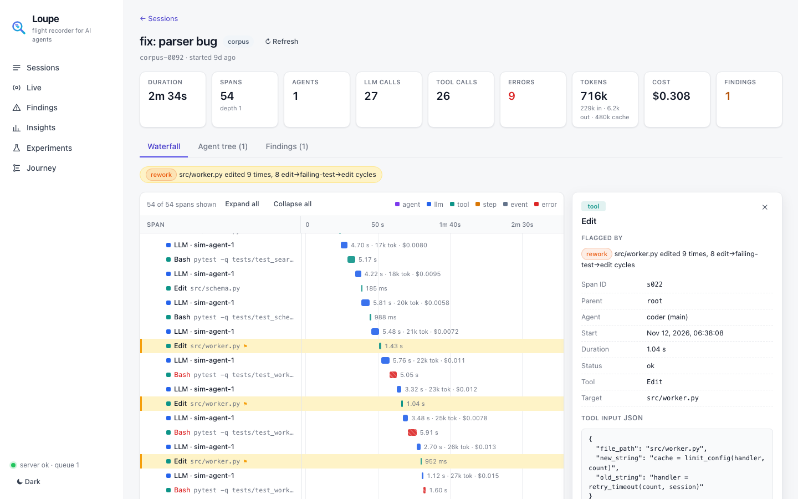
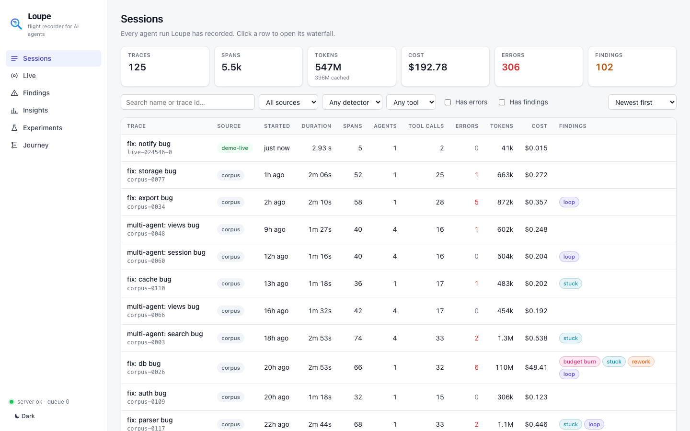
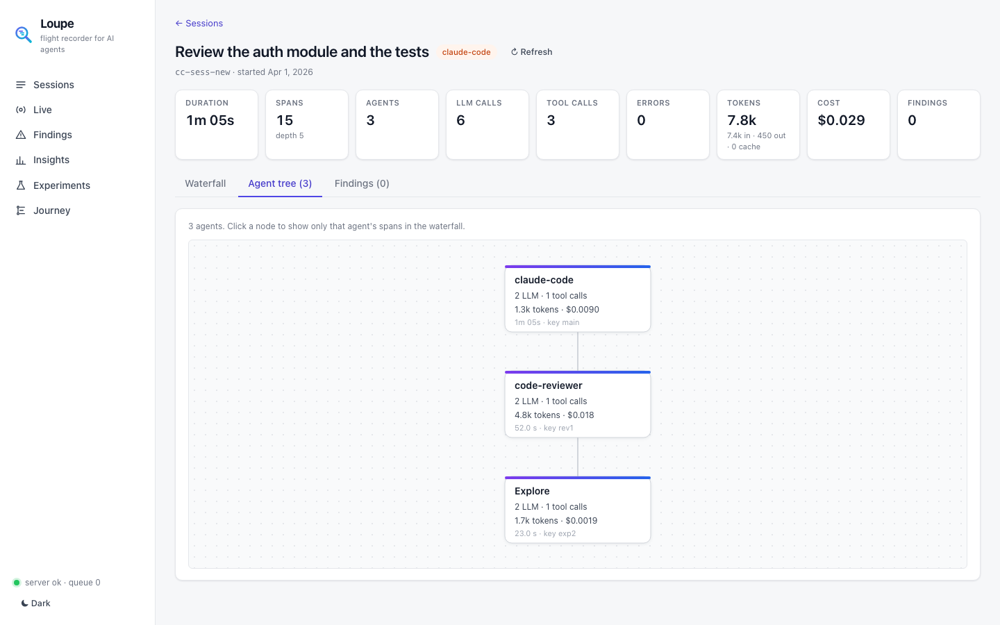
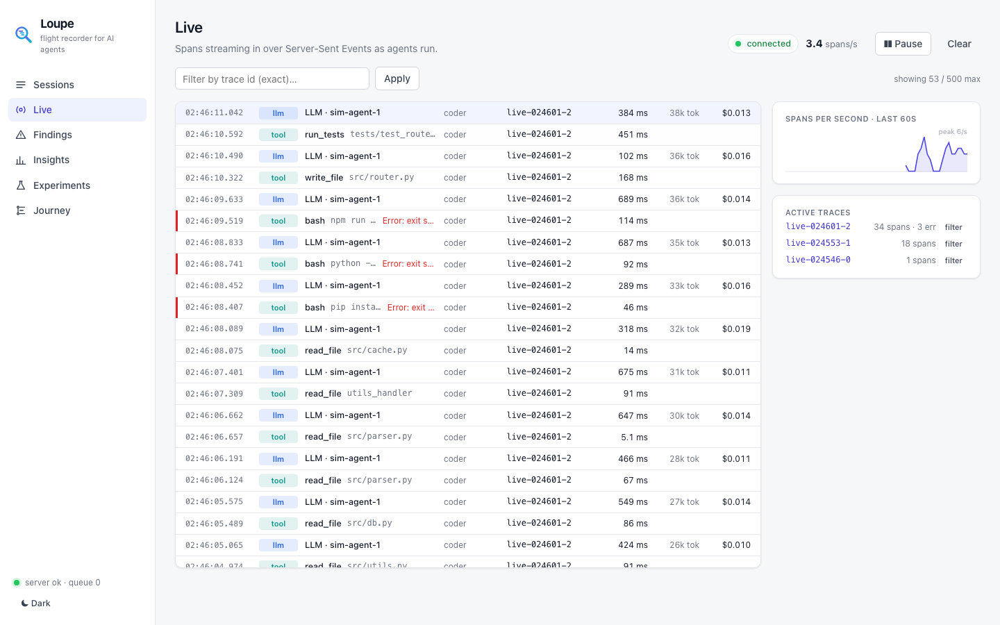
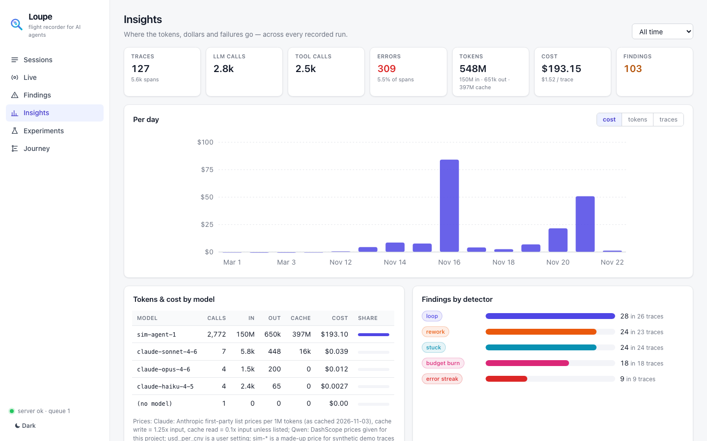
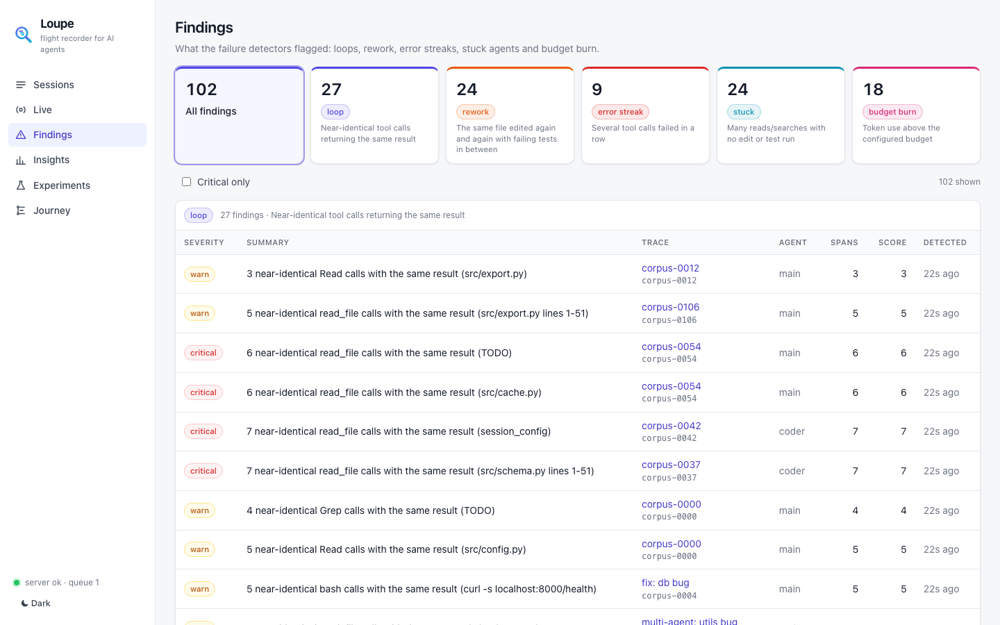
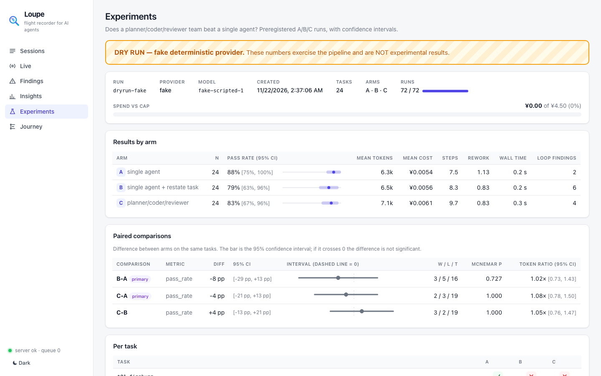
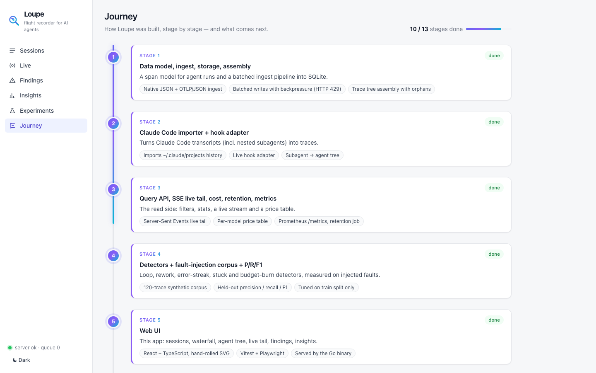

# Loupe — a flight recorder for AI agents

Loupe ingests traces from agent runs — Claude Code sessions, hand-written agent
loops, OpenTelemetry GenAI spans — assembles them into span trees and
multi-agent trees, detects failure patterns (loops, rework, error streaks,
stuck runs, budget burn), and shows it all in a web UI with a waterfall, an
agent-tree graph and a live tail. It also ships a preregistered harness
experiment (single agent vs restate-first vs planner/coder/reviewer) that
traces itself into Loupe.

Go backend (SQLite/WAL, batched ingest with backpressure, SSE, Prometheus
metrics) · Python SDK + mini coding agent · React/TypeScript UI · one-command demo.



## Key metrics

All measured on an Apple M2 laptop (8 cores), localhost, 2026-11-22; see
`BENCHMARK.md` for method and caveats. Synthetic data throughout.

| metric | value | how measured | source |
|---|---|---|---|
| Ingest, batched requests | 137,172 ± 4,166 committed spans/s | loadgen, 50 spans/request, 8 clients, 3 runs, timed until the server wrote everything | `results/bench/summary.md` |
| Ingest, one span per request | 55,027 ± 11,585 spans/s (batched = **2.49x**) | same, 1 span/request | `results/bench/summary.md` |
| Overload with a 5,000-span queue | 574–578 of 600 requests got 429; accepted = written in 3/3 runs; RSS ≤ 62.2 MB | loadgen, 32 clients, no retries | `results/bench/overload.jsonl` |
| Open a trace at 1.02M spans | p50 0.38 ms, p99 0.74 ms | HTTP, sequential, 300 requests × 3 runs | `results/bench/query.jsonl` |
| Open a 10,000-span trace | p50 40.37 ms, p99 47.46 ms (in-process assembly 2.67 ms) | HTTP + `go test -bench` | `results/bench/summary.md` |
| Full aggregate stats at 1.02M spans | p50 2.28 s (known weak spot: full scans) | HTTP, 30 requests × 3 runs | `results/bench/query.jsonl` |
| Claude Code importer | 48.6 ± 2.8 MB/s with SQLite writes; 113.0 ± 3.4 MB/s parse-only | 86.3 MB synthetic transcripts, 3 runs each | `results/bench/import.jsonl` |
| Detectors, held-out synthetic split | macro-F1 0.803 (error_streak 1.00, budget 0.88, rework 0.85, loop 0.73, stuck 0.56) | 150 test traces, thresholds tuned on train only | `results/detectors/test.txt` |
| Tests | 13 Go test packages (race detector, 5x), 28 pytest, 50 Vitest, 10 Playwright — all passing from a fresh clone | `make test`, `make e2e` | "Verification" below |

The harness experiment is **prepared, not run**: the only experiment numbers
in this repo come from a fake scripted model and are labelled as a dry run.


## Project Journey

1. **Data model, ingest, storage, assembly.**
   *Goal:* accept spans from any source without losing or double-counting them.
   *Decision:* one flat `Span` shape for every source; SQLite in WAL mode with
   `(trace_id, span_id)` as primary key (duplicates are ignored → idempotent
   retries); a span-bounded in-memory queue drained by one batching writer.
   Alternatives considered: Postgres (needs a server — wrong for a laptop
   tool), one goroutine per request writing directly (SQLite has one writer;
   they would just fight over the lock).
   *Built:* `server/internal/{model,store,ingest,otlp,assemble}`.
   *Verified:* tests for duplicates inside and across batches, out-of-order
   batches, 200 shuffles of a multi-agent trace giving an identical tree, late
   parents (orphan → attached), cycles, malformed bodies, 429 under a full queue.
   *Problem/fix:* trace summaries double-counted tokens when a client retried —
   fixed by computing summary deltas only from rows that were actually inserted.
2. **Claude Code importer + live hook adapter.**
   *Goal:* see my own Claude Code sessions (tokens, cost, subagent trees).
   *Decision:* build from the documented JSONL shape, depend on few fields,
   count everything unexpected. Deterministic span ids so hook events and later
   imports merge. *Built:* `server/internal/claudeimport`, `importers/claude_hook.py`.
   *Verified:* synthetic fixtures with split assistant lines, missing tool
   results, orphan results, truncated last line, garbage lines, unknown entry
   types, inline (old) and `subagents/` (new) sidechains, nested subagents.
   *Problem/fix:* assistant messages are written as several lines sharing one
   `message.id` with repeated usage → merged by id, otherwise tokens double.
3. **Query API, SSE live tail, cost, retention, metrics, shutdown.**
   *Built:* filters/sort/pagination, span search, aggregates, `/api/v1/live`
   (SSE), longest-prefix price table, Prometheus text `/metrics`, retention,
   graceful shutdown. *Verified:* an integration test SIGTERMs a real binary
   with 3,000 queued spans and an open SSE client; all 3,000 are in SQLite after.
   *Problem/fix:* retention defaulted to 30 days and deleted imported sessions on
   start-up — now opt-in.
4. **Detectors + fault-injection corpus.**
   *Decision:* simple, explainable per-agent rules; measure them on a labelled
   synthetic corpus with a held-out split. *Built:* `internal/detect`,
   `internal/corpus` (300 traces, 5 fault types + clean, noise, hard negatives
   and hard positives). *Measured:* see Key metrics. *Problem/fix:* edit→test
   cycles were flagged as loops → a loop now requires the same output **and**
   no edit between repeats (found on the train split, documented).
5. **Web UI.** React + TypeScript, no UI/chart libraries: sessions, waterfall
   with finding highlights, agent tree (SVG), live tail, findings, insights,
   experiment results, Journey timeline. Vitest + Playwright.
6. **Python SDK, mini coding agent, providers, ledger.** contextvars-based
   SDK exporting OTLP/HTTP JSON; a plain tool-calling loop; DashScope
   provider (key only from env/keyfile); deterministic fake provider; a
   spend ledger that refuses any call whose worst case would exceed the cap.
7. **Preregistered experiment + dry run.** `PREREG.md` committed before any
   real run; resumable runner; analysis with paired bootstrap CIs; full
   72-run dry run with the fake provider (clearly labelled, not results).
   *Problem/fix:* a crash mid-write left a torn JSONL line that swallowed the
   next record → the runner now starts a fresh line on resume.
8. **Benchmarks.** Own load generator and query benchmark, 3 repetitions each,
   raw outputs in `results/bench/` — see `BENCHMARK.md`.
9. **Docs, `make demo`, screenshots.**
10. **Final verification** from a fresh clone (see bottom).

## Why

Bookmarked ideas this project pulls together: multi-agent execution
observability; a "min agent" visual observatory; a console for concurrent
agents; **Agent = Model + Harness** (harness engineering); "make the agent
restate the task to reduce rework"; and multi-agent vs single-agent coding
experiments. Agent-infra job descriptions list tracing/observability as a
core skill, and I use Claude Code daily without knowing where my tokens go,
which tools fail most, or where an agent keeps redoing work. Loupe answers
those questions for my own sessions and gives the harness experiment a place
to record what actually happened in each run.

## Screenshots (demo data)

| Sessions | Agent tree (nested subagents) |
|---|---|
|  |  |
| **Live tail** | **Insights** |
|  |  |
| **Findings** | **Experiment (dry run, fake provider)** |
|  |  |

The Journey page (`/journey`) renders this README's stages as a scroll-animated
timeline: 

## Architecture

```
 Claude Code JSONL ──import-claude──┐     Python SDK ──OTLP/HTTP JSON──┐    Claude Code hooks ──┐
 (~/.claude/projects, offline)      │     (agents/, experiment)        │    (claude_hook.py)    │
                                    │                                  ▼                        ▼
                                    │         ┌───────────── HTTP: POST /api/v1/spans · POST /v1/traces ─────────────┐
                                    │         │ validate/truncate → price table → bounded queue (spans) ──full──► 429 │
                                    │         └──────────────────────────────┬────────────────────────────────────────┘
                                    │                                        │ one writer goroutine, batches ≤2000 spans / 50 ms
                                    ▼                                        ▼
                            ┌──────────────────── SQLite (WAL): spans · traces (incremental summary) · findings ───────────┐
                            └────┬────────────────────┬─────────────────────┬──────────────────────┬─────────────────────┘
                                 ▼                    ▼                     ▼                      ▼
                      query API + assembly     SSE live tail         detectors (on settled     retention · /metrics
                      (tree, agent tree)       (non-blocking fan-out) traces / on demand)
                                 └────────────────────┴────────── React UI (web/dist, served by the Go binary) ──────┘
```

* `server/` — Go module, one binary `bin/loupe` with subcommands (`serve`,
  `import-claude`, `ingest-file`, `detect`, `corpus`, `eval-detectors`,
  `loadgen`, `bench-query`, `gen-transcripts`, `demo-seed`).
* `importers/claude_hook.py` — live hook adapter (stdlib only).
* `sdk/python/loupe_sdk` — tracing SDK. `agents/loupe_agents` — mini agent,
  providers, ledger, fake provider. `experiment/` — tasks, arms, runner, analysis.
* `web/` — React + TypeScript (Vite).

## Quickstart

Requirements: Go 1.27 (per `server/go.mod`), Node (built here with 25), [uv](https://docs.astral.sh/uv/) (Python 3.15 pinned in `.python-version`). Verified only on macOS / Apple Silicon.

```bash
make demo            # builds everything, seeds demo data, serves http://127.0.0.1:7070
```

No API key needed: the demo uses synthetic traces, the synthetic Claude Code
fixtures and the fake-provider experiment runs, plus a simulated agent that
streams into the Live page every few seconds.

```bash
make test            # Go (race detector, 5x) + pytest + vitest
make e2e             # Playwright (starts its own server)
make bench           # all benchmarks (several minutes; close other apps)
make help            # every target
```

## Using it on your own Claude Code sessions

```bash
make import-claude   # reads ~/.claude/projects → data/local.db (gitignored), prints parse stats
make serve-local     # UI on that database
```

For live streaming while you work, add the hook snippet from
[`docs/hooks.md`](docs/hooks.md) to your Claude Code settings. Costs use
[`config/prices.json`](config/prices.json); models missing from it are shown as
"unpriced" rather than guessed.

## Sending your own agent's traces

```python
from loupe_sdk import Tracer, OTLPHttpExporter
tracer = Tracer("my-agent", OTLPHttpExporter("http://127.0.0.1:7070"))
with tracer.agent("coder"):
    with tracer.llm("qwen3.8-flash") as s:
        s.set_usage(input_tokens=812, output_tokens=95)
    with tracer.tool("run_tests", arguments={"path": "."}) as s:
        s.set_result("3 passed")
tracer.shutdown()
```

Any OpenTelemetry exporter configured for OTLP/HTTP **JSON** pointing at
`http://127.0.0.1:7070/v1/traces` works too (`gen_ai.*` attributes are mapped).

## The experiment

`PREREG.md` (hypotheses, analysis, ¥4.50 cap — committed before any real run),
`EXPERIMENT.md` (how to run it: `make experiment` with `DASHSCOPE_API_KEY`
or `LOUPE_KEYFILE`, then `make experiment-report`). The committed
`results/experiment/dryrun-fake/` is a pipeline dry run with a scripted fake
model; its numbers are not results.

## Design decisions and trade-offs

* **SQLite (WAL), two pools.** One write connection (matches SQLite's single
  writer), a multi-connection read pool. Zero-ops and fast enough for a
  laptop; aggregates are full scans (see `/stats` latency in BENCHMARK.md).
  Pure-Go driver (modernc) instead of cgo: simpler builds and race tests,
  slower inserts.
* **Backpressure by rejection.** The queue is bounded in spans; when full the
  server answers 429 + `Retry-After` immediately instead of blocking handlers.
  Memory stays bounded; clients (SDK, importer, loadgen) back off and retry.
* **202 = queued, not durable.** Fast path by default; `?wait=true` returns
  200 only after the batch is committed. Graceful shutdown drains the queue.
* **Assembly at query time.** Storage never waits for parents; the tree is
  built from whatever has arrived, orphans are shown, cycles are broken.
* **Explainable detectors.** Thresholded rules per agent, tuned on a train
  split, reported on a held-out split; every finding points at its spans.
* **Hand-written metrics, no chart library, stdlib-only Python runtime.**
  Fewer dependencies, every line explainable.

## Limitations (honest list)

* The detector corpus is **synthetic** and written by the same author as the
  detectors; scores measure the modelled patterns, not real-world accuracy.
* The importer was tested on synthetic fixtures only; real transcripts may
  contain shapes it doesn't know (they are counted in the parse stats, not
  silently dropped). LLM span durations in imports are approximations.
* OTLP: JSON encoding only (no protobuf/gRPC). No auth — binds to 127.0.0.1.
* `202 Accepted` spans live in memory until committed; a crash (not a
  graceful stop) loses at most one queue's worth.
* All benchmarks are single-machine localhost runs on a shared laptop.
* The harness experiment has **not** been run with a real model yet.

## Next steps

1. Run the preregistered experiment (`make experiment`) and publish the report.
2. Import my own Claude Code history; hand-label a sample to measure detectors on real data.
3. OTLP protobuf/gRPC; a columnar backend (ClickHouse) behind the `store` interface.
4. Semantic progress signals for the stuck detector (e.g. tests passing over time).

## Repository map

| path | what |
|---|---|
| `server/` | Go backend and CLI (`go test -race ./...`) |
| `importers/` | Claude Code hook adapter |
| `sdk/python/` | tracing SDK |
| `agents/` | mini coding agent, providers, spend ledger, fake provider |
| `experiment/` | tasks, arms, runner, analysis |
| `web/` | React UI, Vitest, Playwright |
| `results/` | benchmark raw outputs, detector evaluation, experiment dry run |
| `docs/` | hooks guide, screenshots |
| `PREREG.md` · `EXPERIMENT.md` · `BENCHMARK.md` · `INTERVIEW.md` (中文) · `PROGRESS_LOG.md` | |

## Verification (stage 10, 2026-11-22)

From a fresh `git clone` of this repo into a temp directory:

* `make test` → exit 0: 13 Go packages `ok` under `go test -race -count=5 ./...`,
  `28 passed` (pytest), `50 passed` (Vitest).
* `make e2e` → `10 passed` (Playwright, own server on a freshly seeded DB).
* `make demo PORT=7071` → UI served, 197 traces (120 synthetic, 4 Claude Code
  fixtures, 72 experiment dry-run traces, plus live demo runs), 1 experiment
  report; then stopped.
* `git log -p --all` scanned for key-like strings (`sk-…`, `AKIA…`, `AIza…`,
  `ghp_…`, private-key headers, long bearer tokens): only the fake test
  values `sk-test-123`, `sk-from-env`, `sk-from-file` and CSS class names
  like `task-matrix`. No tracked `.env`/key files. No `Co-Authored-By` lines.
* No Loupe/Vite/Playwright processes left running.
